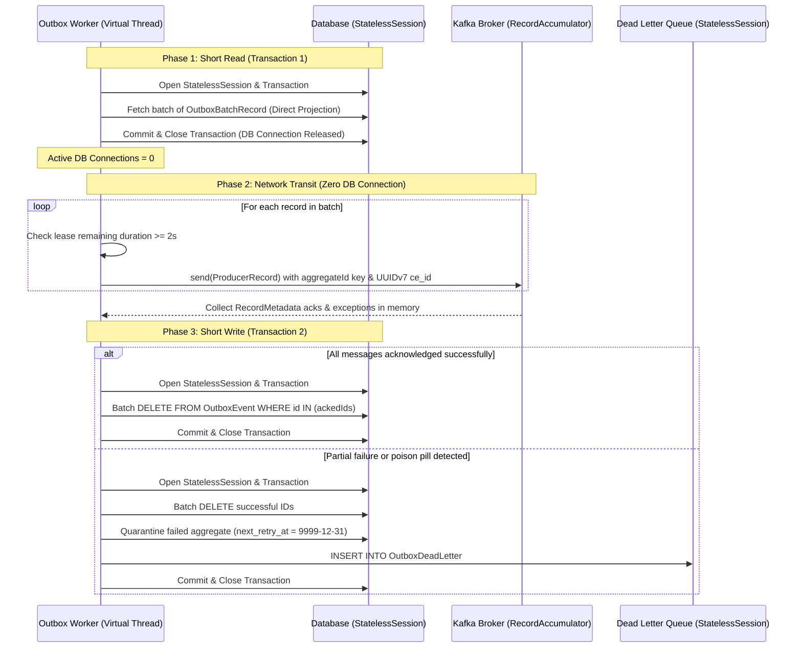
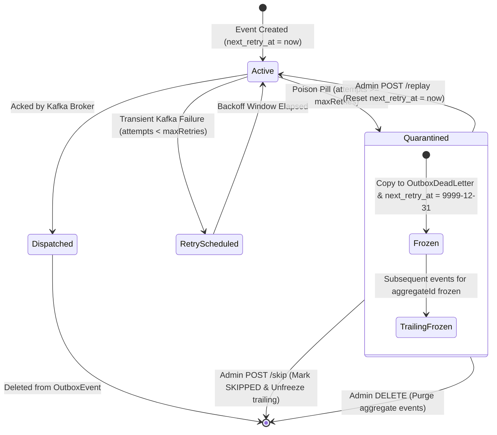

# Mermaid Diagram Templates for Quarkus Outbox Kafka

## 1. Short-Transaction Sandwich (3-Phase Dispatch Lifecycle)



## 2. Multi-Pod Virtual Bucketing System Topology

```mermaid
graph TD
    subgraph Client Application
        App["Business Service / API"] -->|"1. RequiringNew Transaction"| DB_Write[("RDBMS (OutboxEvent)")]
    end

    subgraph Cluster Deployment (Active-Active Pods)
        subgraph Pod 1
            Worker1["Outbox Worker Pod 1"]
            Heartbeat1["Virtual Thread Heartbeat Supervisor"]
        end
        subgraph Pod 2
            Worker2["Outbox Worker Pod 2"]
            Heartbeat2["Virtual Thread Heartbeat Supervisor"]
        end
    end

    subgraph Database Infrastructure
        DB_Write --- LockTable[("OutboxLock (M = 1024 Rows)")]
        DB_Write --- EventTable[("OutboxEvent (Generation Partitioned)")]
    end

    subgraph Kafka Messaging Cluster
        Topic["Kafka Topic (Partitioned by Murmur2(aggregateId))"]
    end

    Heartbeat1 -->|"JPQL CAS Lease (Bulkhead outbox-lock Pool)"| LockTable
    Heartbeat2 -->|"JPQL CAS Lease (Bulkhead outbox-lock Pool)"| LockTable

    Worker1 -->|"Leases Buckets 0..511"| EventTable
    Worker2 -->|"Leases Buckets 512..1023"| EventTable

    Worker1 -->|"Network Send (ce_id UUIDv7)"| Topic
    Worker2 -->|"Network Send (ce_id UUIDv7)"| Topic
```

## 3. Aggregate Quarantining State Diagram


